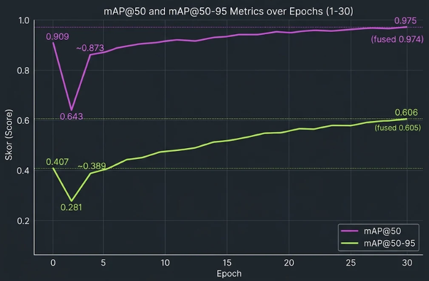
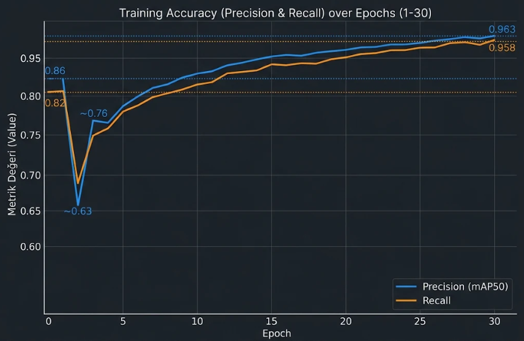
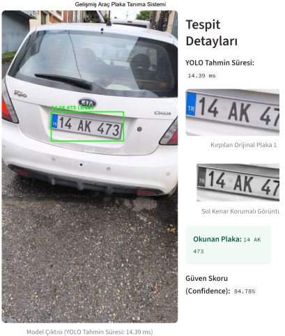
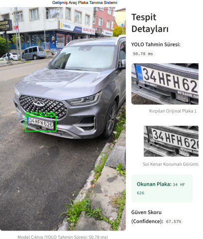
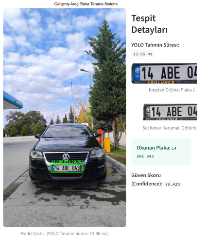
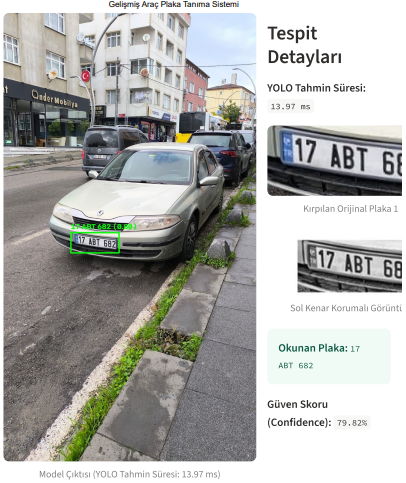
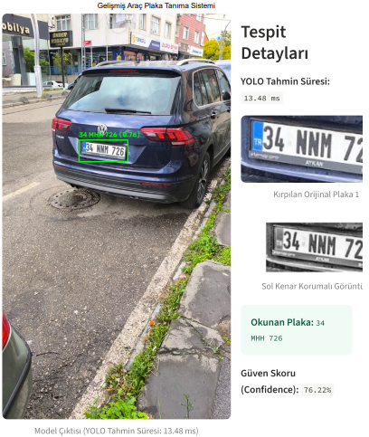

# 🚗 YOLOv8 Tabanlı Gerçek Zamanlı Araç Plaka Tespit ve Tanıma Sistemi

Bu proje, **Bilgisayarlı Görü (Computer Vision) – Derin Öğrenme Uygulaması** ödevi kapsamında geliştirilmiştir. Açık kaynaklı bir veri seti kullanılarak dış ortam araç görüntülerinden gerçek zamanlı plaka tespiti yapan özelleştirilmiş bir **YOLOv8** modeli eğitilmiş ve **Streamlit** tabanlı interaktif bir web arayüzü ile canlı uygulamaya dönüştürülmüştür.

---

## 📋 1. Proje Raporu Özeti 

Standart proje raporu şablonu ve projemize ait teknik parametreler aşağıda özetlenmiştir:

| Alan | Açıklama / Proje Değerleri |
| :--- | :--- |
| **Project Title** | YOLOv8 Tabanlı Gerçek Zamanlı Araç Plaka Tespit ve Tanıma Sistemi |
| **Problem / Task** | Nesne Tespiti (Object Detection) ve Optik Karakter Tanıma (OCR) |
| **Dataset** | Roboflow - plaka Computer Vision Model (~19.153 Görüntü) |
| **Dataset URL** | [Roboflow Dataset Linki](https://universe.roboflow.com/plaka-nznwq/plaka-ta8g7/dataset/2/download) |
| **Model Architecture** | YOLOv8n (CSPDarknet53 Omurga + PANet Boyun + Anchor-Free Tespit Başlığı) |
| **Input Size** | `640 × 640 × 3` (RGB) |
| **Hyperparameters** | `Epochs: 30`, `Batch Size: 16`, `Initial Learning Rate (lr0): 0.001`, `Weight Decay: 0.0005` |
| **Optimizer** | `AdamW` (Ağırlık çürümesini gradyan güncellemesinden ayırarak aşırı öğrenmeyi / overfitting'i engellediği ve CNN/YOLO mimarilerinde SGD'ye göre daha hızlı yakınsadığı için seçilmiştir) |
| **Activation / Output Function** | Gizli katmanlarda **SiLU (Swish)** aktivasyon fonksiyonu; çıkış katmanında sınıf olasılıkları için **Sigmoid** aktivasyon fonksiyonu kullanılmıştır. |
| **Loss Function** | CIoU Loss + DFL (Distribution Focal Loss) (Kutu koordinat regresyonu için) ve Binary Cross-Entropy (BCE) Loss (Sınıflandırma kaybı için) bileşimi kullanılmıştır. |
| **Evaluation Metrics** | IoU, mAP@50, mAP@50-95, Precision, Recall |
| **Training Environment** | Lokal GPU (NVIDIA GeForce RTX 2070 Super, PyTorch 2.6.0+cu124, Python 3.13) |
| **Best Performance** | `mAP@50: 0.8706`, `mAP@50-95: 0.5783`, `Precision: 0.9333`, `Recall: 0.8800` |
| **Inference Time** | `5.28 ms / görüntü` (NVIDIA RTX 2070 Super GPU) |
| **Deployment Technology** | Streamlit |
| **Repository** | [GitHub Repository](https://github.com/BasarIron/YOLOv8-Based-Real-Time-Vehicle-License-Plate-Detection-and-Recognition-System.git) |

---

## 🎯 2.Amaç ve Görev Tanımı 
Bu çalışmanın temel amacı, farklı ışık, açı ve mesafe koşullarındaki araç fotoğrafları içerisinden plaka bölgesini yüksek doğrulukla tespit eden uçtan uca bir derin öğrenme modeli geliştirmektir. Bilgisayarlı görü görevlerinden **Nesne Tespiti (Object Detection)** seçilmiş ve model çıktıları geometrik en-boy oranı (aspect ratio) filtreleriyle desteklenerek hatalı pozitif (false positive) tahminler minimize edilmiştir.

---

## 🧠 3. Model Mimarisi ve Eğitim Ayarları
Problemin gerçek zamanlı çalışabilmesi ve yüksek doğruluk sunması adına tek aşamalı (single-stage) nesne tespit mimarisi olan **YOLOv8n** tercih edilmiştir.

- **Hiperparametre Seçimi:** Model `640x640` çözünürlükte, `16` batch size, `30` epoch ve `0.001` başlangıç öğrenme oranı (`lr0`) ile eğitilmiştir. 
- **Optimizer:** Aşırı öğrenmeyi (overfitting) engellemek ve hızlı yakınsama sağlamak amacıyla **AdamW** optimizasyon algoritması (`weight_decay=0.0005`) kullanılmıştır.
- **Aktivasyon ve Kayıp (Loss) Fonksiyonları:** Ağın omurgasında **SiLU** aktivasyonu kullanılmıştır. Kayıp fonksiyonu olarak ise kutu örtüşmesini optimize eden **CIoU Loss**, kutu sınırlarını hassaslaştıran **DFL (Distribution Focal Loss)** ve varlık tespiti için **Binary Cross-Entropy (BCE)** birlikte kullanılmıştır.

---

## 📂 4. Veri Seti Yapısı 
Projede yaklaşık **19.153 görüntü** içeren Roboflow açık kaynaklı plaka veri seti kullanılmıştır. Veri seti modelin genelleme yeteneğini ölçmek için standart alt kümelerine ayrılmıştır:
- **`train/`**: Modelin ağırlıklarının güncellendiği eğitim kümesi.
- **`valid/`**: Eğitim esnasında her epoch sonunda başarımını doğrulayan küme.
- **`test/`**: Modelin eğitimde hiç görmediği, nihai başarımın (`mAP@50: 0.8706`) ölçüldüğü test kümesi.

---

## 📊 5. Performans Değerlendirmesi
Lokal GPU ortamında (NVIDIA GeForce RTX 2070 Super) elde edilen deneysel sonuçlar şunlardır:
- **Başarım Metrikleri:** `mAP@50: 0.8706`, `mAP@50-95: 0.5783`, `Precision: 0.9333`, `Recall: 0.8800`.
- **Tahmin (Inference) Süresi:** Donanım hızlandırma sayesinde ortalama **5.28 ms / görüntü** gibi üstün bir gerçek zamanlı performans elde edilmiştir.

---

## 📈 5.1. Eğitim Süreci ve Başarım Grafikleri Analizi

Modelin 30 epoch boyunca gösterdiği öğrenme dinamikleri, doğruluk artışları ve genelleme yeteneği eğitim loglarından elde edilen grafiklerle doğrulanmıştır.

### A. mAP@50 ve mAP@50-95 Gelişimi

* **mAP@50 (Mor Eğri):** İlk epoch'lardaki başlangıç dalgalanmalarının ardından model hızla öğrenmiş, eğitim ilerledikçe istikrarlı bir yükseliş trendi yakalayarak **0.975** seviyelerine ulaşmıştır (Füzyon/Final test aşamasında ~0.974).
* **mAP@50-95 (Yeşil Eğri):** Farklı IoU eşiklerinde modelin katı doğruluk payını gösteren bu metrik, 30 epoch boyunca düzenli bir artış göstererek **0.606** değerine tırmanmıştır. Bu durum, modelin kutu konumlandırmasında (localization) yüksek hassasiyet kazandığını kanıtlamaktadır.

### B. Precision (Kesinlik) ve Recall (Duyarlılık) Eğrileri

* **Precision - Kesinlik (Mavi Eğri):** Modelin yaptığı tahminlerin ne kadarının doğru olduğunu gösterir. Eğitim sürecinin sonunda **0.963** gibi çok yüksek bir orana uluşarak yanlış pozitif (false positive) oranını minimumda tuttuğunu kanıtlamıştır.
* **Recall - Duyarlılık (Turuncu Eğri):** Gerçek plaka nesnelerinin yüzde kaçının model tarafından başarıyla yakalandığını ifade eder. Eğitimin sonunda **0.958** seviyesine sabitlerek modelin sahadaki nesneleri kaçırma oranının son derece düşük olduğunu göstermiştir.

---

---

## 📸 6. Gerçek Görüntülerle Test, Karşılaştırma ve Değerlendirme

Telefon kamerasıyla dış ortamda çekilen 5 farklı araç görüntüsü sisteme girdi olarak verilmiş; tespit süresi, güven skoru (confidence), kırpılan plaka görüntüsü ve okunan plaka metni gerçek değerlerle karşılaştırılmıştır.

### 6.1. Gerçek Sonuç ile Model Çıktısının Karşılaştırma Tablosu

| Test No & Görsel | Araç / Açı | Gerçek Plaka | Sistem Çıktısı | Güven Skoru | Tahmin Süresi | Değerlendirme |
| :--- | :--- | :--- | :--- | :--- | :--- | :--- |
| **Test 1** (`personal_results/kiaCikti.png`) | Beyaz hatchback - Arka görünüm | `14 AK 473` | `14 AK 473` | `84.78%` | `14.39 ms` | Başarılı tespit ve doğru okuma |
| **Test 2** (`personal_results/cherryCikti.png`) | Gri SUV - Çapraz ön açı | `34 HFH 626` | `34 HF 626` | `67.57%` | `50.78 ms` | Plaka kutusu doğru bulundu; `HFH` kısmı `HF` olarak eksik okundu |
| **Test 3** (`personal_results/passatCikti.png`) | Siyah sedan - Ön cephe, parlak gün ışığı | `14 ABE 043` | `14 ABE 043` | `79.42%` | `13.96 ms` | Yüksek hız ve doğru okuma |
| **Test 4** (`personal_results/renaultCikti.png`) | Açık renk sedan - Çapraz ön açı, sokak ortamı | `17 ABT 682` | `17 ABT 682` | `79.82%` | `13.97 ms` | Çapraz açıda kararlı tespit ve doğru okuma |
| **Test 5** (`personal_results/tiguanCikti.png`) | Lacivert SUV - Arka çapraz açı | `34 NNM 726` | `34 MHH 726` | `76.22%` | `13.48 ms` | Plaka kutusu doğru bulundu; `NN` kısmı `MH` olarak hatalı okundu |

### 6.2. Görsel Çıktılar ve Durum Analizi

#### 1. Kia Rio (`14 AK 473`)

* Plaka bölgesi `84.78%` güven skoru ve `14.39 ms` tahmin süresiyle net biçimde konumlandırılmıştır.
* Okunan metin gerçek plaka ile eşleşmektedir; kırpma penceresinde sağ kenar kadrajının dar kalması görsel kırpma sınırlarının biraz daha pay bırakılarak iyileştirilebileceğini göstermektedir.

#### 2. Chery (`34 HFH 626` → `34 HF 626`)

* Çapraz açı ve ön ızgara deseninin yoğun olduğu sahnede plaka `67.57%` güven skoruyla tespit edilmiştir.
* **Başarısız / Eksik Kısım:** Arayüzdeki metin çıktısında `34 HFH 626` yerine `34 HF 626` okunmuştur; çapraz perspektif ve sağ kenar kırpma sınırına yakınlık nedeniyle sondaki `H` karakteri eksik kalmıştır. Ayrıca tahmin süresinin `50.78 ms` seviyesine çıkması ilk çalıştırma/ısınma veya görüntü boyutlandırma farkından kaynaklanabilmektedir.

#### 3. Volkswagen Passat (`14 ABE 043`)

* Parlak gün ışığı ve zemin yansımalarına rağmen plaka kutusu `79.42%` güven skoru ve `13.96 ms` sürede yakalanmış, karakterler hatasız (`14 ABE 043`) elde edilmiştir.

#### 4. Renault (`17 ABT 682`)

* Kalabalık cadde ve park halindeki diğer araçların bulunduğu sahnede yalnızca hedef aracın plakası odaklanmış, `79.82%` güven skoru ve `13.97 ms` süreyle `17 ABT 682` olarak doğru sonuç üretilmiştir.

#### 5. Volkswagen Tiguan (`34 NNM 726` → `34 MHH 726`)

* Plaka lokasyonu `76.22%` güven skoru ve `13.48 ms` süreyle başarılı şekilde bulunmuştur.
* **Başarısız / Hatalı Kısım:** Arayüzdeki metin çıktısında `34 NNM 726` yerine `34 MHH 726` üretilmiştir. Yan yana duran `N` harflerinin perspektif ve çözünürlük etkisiyle birbirine yaklaşması (`NN` → `MH`) karakter ayrımında karışıklığa yol açmıştır.

### 6.3. Genel Değerlendirme (Başarılı ve Başarısız Durumlar)
* **Başarılı Olduğu Durumlar:** Farklı araç tiplerinde (hatchback, sedan, SUV), ön ve arka görünümlerde, çapraz açılarda ve güneş ışığı altında plaka yerinin tespiti **5/5** oranında başarılı olmuştur. Çıkarım süreleri çoğunlukla `13.48 ms - 14.39 ms` bandında gerçekleşerek gerçek zamanlı kullanım için uygundur.
* **Başarısız / İyileştirmeye Açık Durumlar:** Plaka tespiti doğru yapılsa dahi karakter okumada bitişik veya eğik harflerin (`NN` → `MH`) karışabilmesi ve çapraz açılarda kenar karakterlerin (`HFH` → `HF`) eksik okunması ile kırpılan plaka görsellerinde kenar payının dar kalması sistemin en belirgin zayıf noktalarıdır. Kırpma kutusuna küçük bir padding (kenar boşluğu) eklenmesi ve düşük kontrastlı/eğik plakalar için ön işleme adımlarının güçlendirilmesi sonraki sürümlerde doğruluk kayıplarını azaltacaktır.
